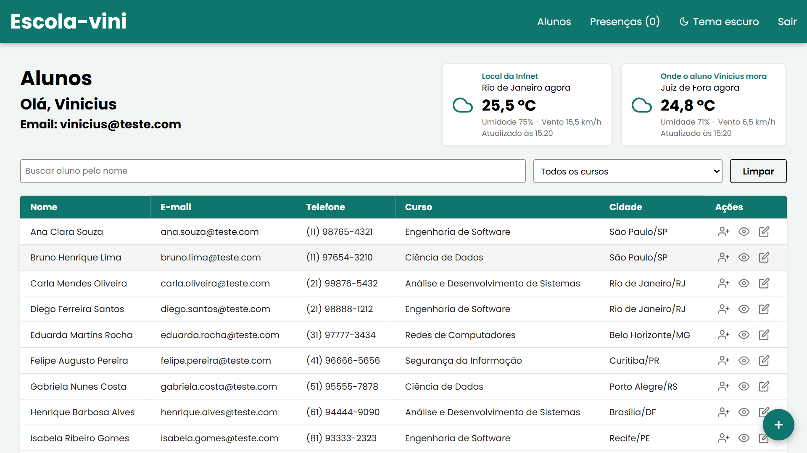
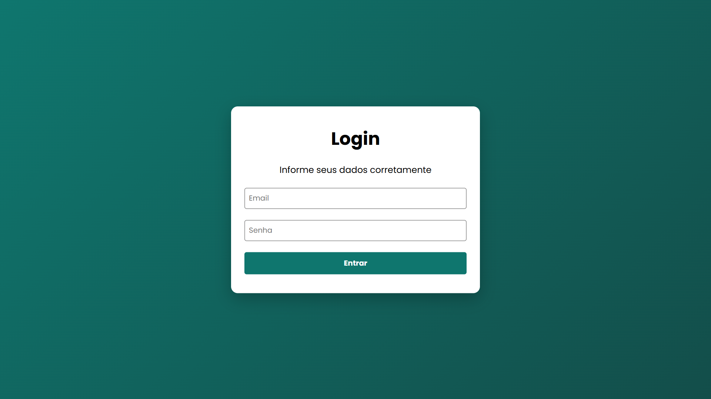
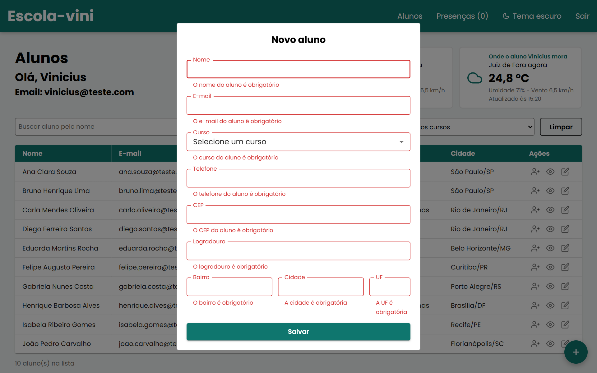
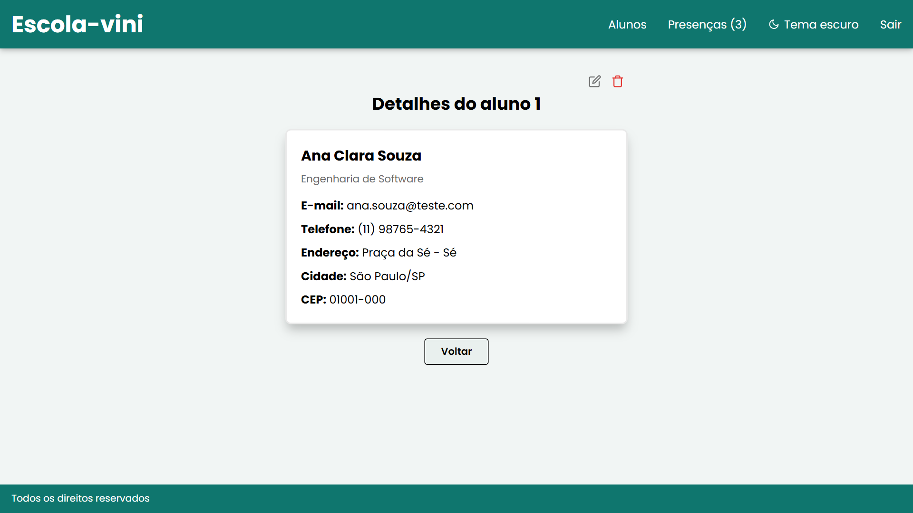
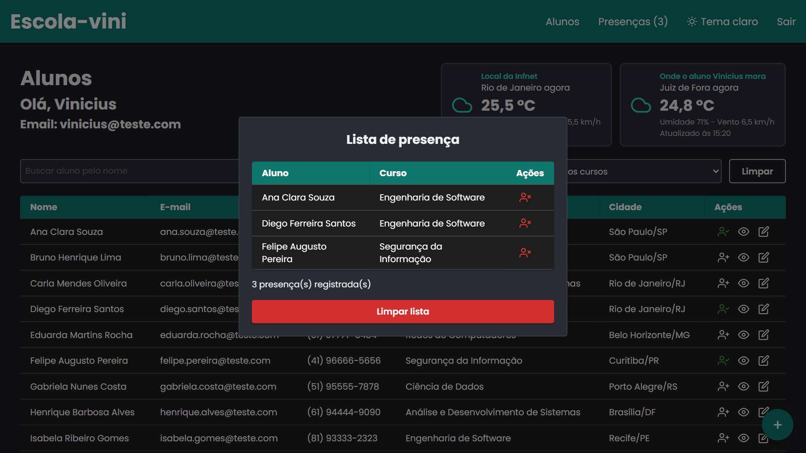

# Escola-vini

Sistema de gestão escolar com CRUD completo de alunos, feito em **React + TypeScript** (Vite) e com uma API em **Express**. É o Projeto de Disciplina de React da pós-graduação do Instituto Infnet.

Quem usa é a secretaria da escola: faz login, vê a lista de alunos, cadastra, consulta os detalhes, edita, exclui e marca a presença do dia. O endereço do aluno é preenchido sozinho a partir do CEP e a página inicial mostra o clima do momento em duas cidades: o Rio de Janeiro, onde fica a Infnet, e Juiz de Fora, onde eu moro.



## Sumário

- [Funcionalidades](#funcionalidades)
- [Tecnologias](#tecnologias)
- [Como executar](#como-executar)
- [Configuração](#configuração)
- [Scripts](#scripts)
- [Estrutura do projeto](#estrutura-do-projeto)
- [Rotas da aplicação](#rotas-da-aplicação)
- [API](#api)
- [Onde está cada requisito do trabalho](#onde-está-cada-requisito-do-trabalho)
- [Testes em navegadores](#testes-em-navegadores)
- [Telas](#telas)
- [Créditos](#créditos)
- [Autor](#autor)

## Funcionalidades

- **Login** com e-mail e senha. O token fica guardado e as páginas internas só abrem para quem está logado.
- **Listagem de alunos** em tabela, com busca pelo nome e filtro por curso.
- **Cadastro de aluno** em um modal, com validação campo a campo.
- **Busca de CEP**: ao digitar o CEP, logradouro, bairro, cidade e UF são preenchidos pelo ViaCEP.
- **Detalhes, edição e exclusão** em páginas próprias. A exclusão pede confirmação mostrando o nome do aluno.
- **Lista de presença**: marca e desmarca direto na tabela, com contador no cabeçalho.
- **Clima do dia** na página inicial, em dois cartões lado a lado (Rio de Janeiro e Juiz de Fora), atualizados sozinhos a cada 5 minutos.
- **Tema claro e escuro**, que continua salvo depois de fechar o navegador.
- **Avisos** de sucesso e de erro em todas as ações.

## Tecnologias

| Parte | Tecnologias |
| --- | --- |
| Frontend | React 19, TypeScript, Vite, React Router, TanStack React Query, Axios, Redux Toolkit + React Redux, Zustand, React Hook Form + Yup, Material UI, React Modal, React Toastify, React Icons |
| Backend | Node.js, Express 5, TypeScript, Zod, JWT (jsonwebtoken + express-jwt), bcrypt, lru-cache, rate-limiter-flexible, Helmet, CORS |
| APIs externas | [ViaCEP](https://viacep.com.br/) (endereço pelo CEP) e [Open-Meteo](https://open-meteo.com/) (clima), as duas gratuitas e sem chave |

## Como executar

Você precisa do **Node.js 22 ou mais novo** (testado com a versão 22.14) e do npm. O projeto tem duas partes que rodam ao mesmo tempo: o backend e o frontend.

**1. Clone o repositório**

```bash
git clone https://github.com/Viniciusrz7/trabalho-react-infnet-.git
cd trabalho-react-infnet-
```

**2. Suba o backend** (porta 3001)

```bash
cd backend
npm install
cp .env.example .env
npm run dev
```

**3. Em outro terminal, suba o frontend** (porta 5173)

```bash
npm install
npm run dev
```

**4. Abra** <http://localhost:5173> e entre com o usuário de teste:

| E-mail | Senha |
| --- | --- |
| `vinicius@teste.com` | `123456` |

> Os dados ficam na memória do backend. Ao reiniciar o backend, a lista volta para os 10 alunos iniciais.

## Configuração

O backend lê as variáveis do arquivo `backend/.env`. O `backend/.env.example` já vem com valores que funcionam na sua máquina.

| Variável | Para que serve | Padrão do exemplo |
| --- | --- | --- |
| `PORT` | Porta da API | `3001` |
| `ORIGEM_PERMITIDA` | Endereço do frontend liberado no CORS | `http://localhost:5173` |
| `LATENCIA_MS` | Atraso de propósito em cada resposta, para dar tempo de ver as telas de carregamento | `1500` |
| `JWT_SECRET` | Segredo usado para assinar o token de login. É obrigatório | texto de exemplo, troque por outro |

O frontend chama a API em `http://localhost:3001`. Se mudar a porta do backend, ajuste também em `src/service/api.ts` e em `src/pages/login/index.tsx`.

## Scripts

Na raiz (frontend):

| Comando | O que faz |
| --- | --- |
| `npm run dev` | Sobe o Vite em modo de desenvolvimento |
| `npm run build` | Confere os tipos e gera a versão de produção em `dist/` |
| `npm run preview` | Serve a versão gerada pelo build |
| `npm run lint` | Roda o ESLint |

Na pasta `backend/`:

| Comando | O que faz |
| --- | --- |
| `npm run dev` | Sobe a API e reinicia a cada alteração |
| `npm run build` | Compila o TypeScript para `dist/` |
| `npm start` | Roda a versão compilada |
| `npm run typecheck` | Só confere os tipos |

## Estrutura do projeto

```text
trabalho-react-infnet-/
├── backend/                 API em Express
│   └── src/
│       ├── routes/          endereços da API
│       ├── controllers/     recebem a requisição e devolvem a resposta
│       ├── services/        regras de negócio e cache
│       ├── repositories/    leitura e escrita dos dados
│       ├── data/            dados iniciais em JSON
│       ├── schemas/         validação com Zod
│       ├── middlewares/     verificação do token
│       ├── errors/          erros da aplicação
│       └── performance/     latência e limite de tentativas de login
└── src/                     frontend em React
    ├── pages/               login, home, detalhes, editar e notFound
    ├── components/          AlunoForm, Tabela, Botao, BotaoAcao, Modal, Presencas, Clima, Footer, PrivateRoute
    ├── templates/           container com cabeçalho e rodapé
    ├── hooks/               useAuth, useFormulario e useCursos
    ├── contexts/            tema claro e escuro (Context API)
    ├── store/               lista de presença (Redux)
    ├── service/             chamadas de API (alunos, cursos, ViaCEP e clima)
    ├── schemas/             validação do formulário de aluno (Yup)
    └── utils/               avisos, mensagens de erro e chaves do localStorage
```

Cada componente e cada página tem a sua pasta com um `index.tsx` e um `styles.css`.

## Rotas da aplicação

| Rota | Página | Acesso |
| --- | --- | --- |
| `/` | Login | Livre |
| `/home` | Lista de alunos | Só logado |
| `/aluno/:id` | Detalhes do aluno | Só logado |
| `/aluno/:id/editar` | Edição do aluno | Só logado |
| qualquer outra | Página 404 | Livre |

## API

Todas as rotas de alunos e cursos pedem o cabeçalho `Authorization: Bearer <token>`.

| Método | Rota | O que faz |
| --- | --- | --- |
| `POST` | `/auth/login` | Recebe `email` e `password` e devolve `token` e `usuario` |
| `GET` | `/alunos` | Lista os alunos |
| `GET` | `/alunos/:id` | Busca um aluno |
| `POST` | `/alunos` | Cadastra um aluno |
| `PUT` | `/alunos/:id` | Atualiza um aluno |
| `DELETE` | `/alunos/:id` | Exclui um aluno |
| `GET` | `/cursos` | Lista os cursos |

Exemplo de aluno:

```json
{
  "id": 1,
  "nome": "Ana Clara Souza",
  "email": "ana.souza@teste.com",
  "telefone": "(11) 98765-4321",
  "curso": "Engenharia de Software",
  "cep": "01001-000",
  "logradouro": "Praça da Sé",
  "bairro": "Sé",
  "cidade": "São Paulo",
  "uf": "SP"
}
```

Os erros sempre vêm no formato `{ "erro": "mensagem" }`:

| Status | Quando acontece |
| --- | --- |
| `400` | Id inválido na URL |
| `401` | Sem token, token vencido ou login incorreto |
| `404` | Aluno ou rota não encontrados |
| `409` | Já existe um aluno com o mesmo e-mail |
| `422` | Dados enviados não passaram na validação |
| `429` | Muitas tentativas de login |

## Onde está cada requisito do trabalho

| Requisito do enunciado | Onde ver no código |
| --- | --- |
| Arrow functions nas ações do CRUD | `src/service/alunos.ts` |
| Destructuring ao criar e atualizar | `postAluno` e `putAluno` em `src/service/alunos.ts` |
| Spread e rest | `src/hooks/useFormulario.ts`, `src/store/presencaSlice.ts`, `putAluno` |
| Template literals | Confirmação de exclusão em `src/pages/detalhes/index.tsx` |
| Componentes reutilizáveis | `src/components/AlunoForm`, `Tabela`, `Botao`, `BotaoAcao`, `Modal` |
| Componente de classe | `src/components/Footer/index.tsx` |
| `useState` e `useEffect` | `src/hooks/useCursos.ts`, `src/components/AlunoForm/index.tsx` |
| Hook personalizado | `src/hooks/useFormulario.ts`, `src/hooks/useCursos.ts` |
| Context API | `src/contexts/themeContext.tsx` (tema claro e escuro) |
| Redux, `useSelector` e `useDispatch` | `src/store/`, `src/components/Presencas`, `src/pages/home`, `src/templates/container` |
| Formulário controlado | Login e filtro da lista |
| Formulário não controlado com validação | `src/components/AlunoForm` (React Hook Form) e `src/schemas/alunos.schema.ts` (Yup) |
| Axios com GET, POST, PUT e DELETE | `src/service/alunos.ts` e `src/service/cursos.ts` |
| React Query (cache e atualização automática) | `src/pages/home`, `src/pages/detalhes`, `src/pages/editar`, `src/components/Clima`, consulta do CEP em `src/components/AlunoForm` |
| API real | ViaCEP em `src/service/viacep.ts` e Open-Meteo em `src/service/clima.ts` |
| `Promise.race` e `AbortController` | `src/service/viacep.ts` |
| React Router e rota privada | `src/App.tsx` e `src/components/PrivateRoute` |
| Componentes de terceiros | Material UI na tabela, nos campos, nos botões e nos alertas, com as cores dos botões nos `styles.css` |
| Tratamento de erros com alertas | `src/utils/erros.ts`, `src/utils/toast.ts` e os `onError` das páginas |

## Testes em navegadores

O fluxo completo (login, rota privada, listagem e filtros, cadastro com CEP, detalhes, edição, exclusão, presença, clima e página 404) foi conferido em quatro navegadores:

| Navegador | Versão |
| --- | --- |
| Google Chrome | 157 |
| Microsoft Edge | 157 |
| Mozilla Firefox | 159 |
| WebKit (motor do Safari) | 27.2 |

## Telas

| Login | Cadastro com validação |
| --- | --- |
|  |  |

| Detalhes do aluno | Tema escuro com lista de presença |
| --- | --- |
|  |  |

## Créditos

- A estrutura do projeto segue o que foi feito nas aulas de React do Instituto Infnet.
- Documentações oficiais consultadas: [React](https://react.dev/), [Vite](https://vite.dev/), [React Router](https://reactrouter.com/), [TanStack Query](https://tanstack.com/query/latest), [Redux Toolkit](https://redux-toolkit.js.org/), [Material UI](https://mui.com/material-ui/), [React Hook Form](https://react-hook-form.com/), [Axios](https://axios-http.com/) e [MDN](https://developer.mozilla.org/).
- Dados de endereço: [ViaCEP](https://viacep.com.br/). Dados de clima: [Open-Meteo](https://open-meteo.com/).
- Ferramenta de IA: o [Claude](https://claude.com/product/claude-code) (Anthropic) foi usado como apoio no desenvolvimento, na geração e revisão de trechos de código, nos estilos, nos dados de teste e nos testes em navegadores, conforme a política de uso de IA da disciplina. Os commits feitos com esse apoio estão marcados com `Co-Authored-By`.

## Autor

Vinicius Zimmermann — [@Viniciusrz7](https://github.com/Viniciusrz7)
